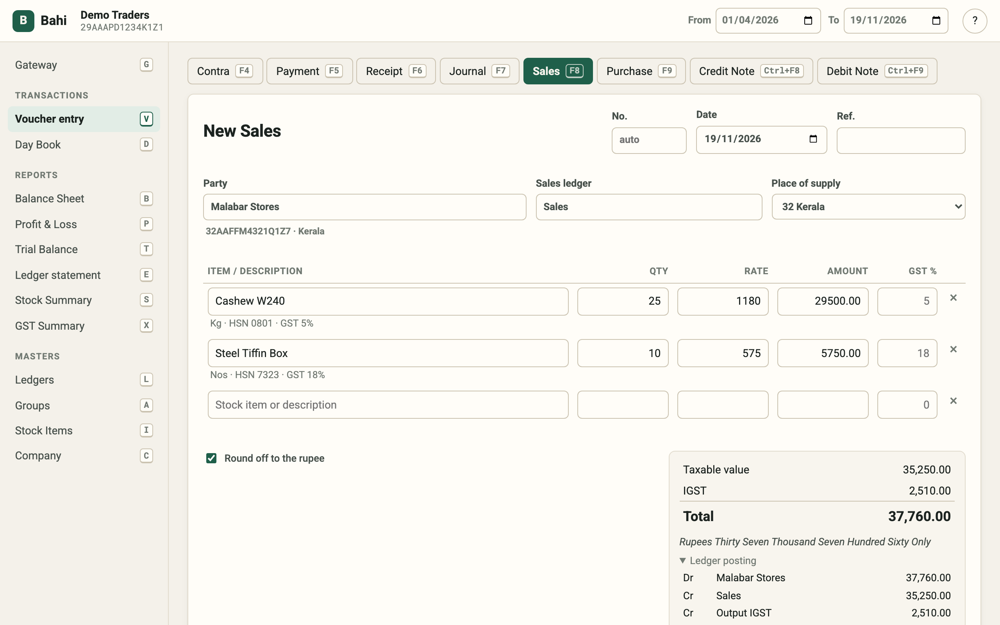
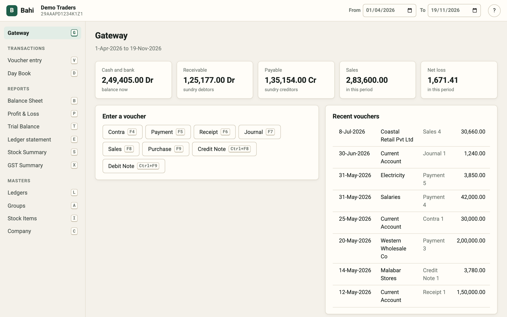
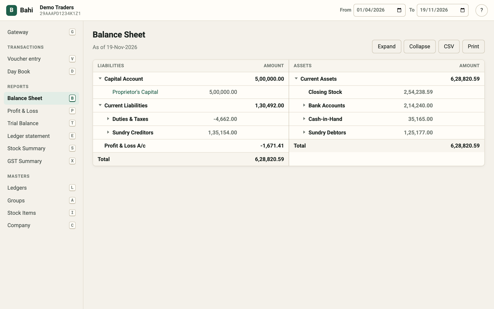
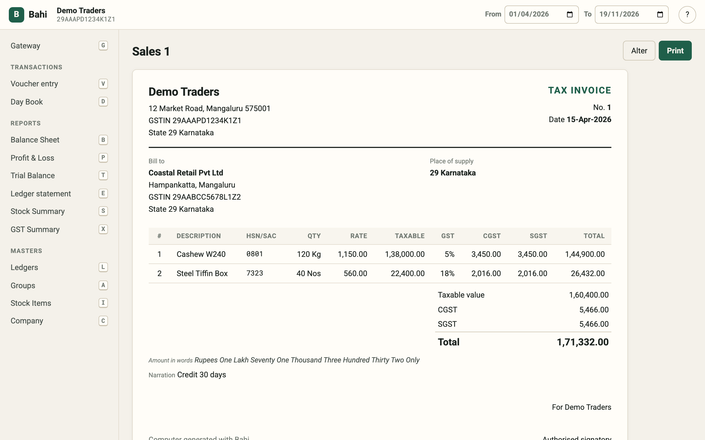

# Bahi

**Open-source, keyboard-first double-entry accounting for Indian businesses, with GST built in.**

An open-source alternative to TallyPrime-style desktop accounting: if you've used Tally, the Gateway, the F-key voucher entry and the Day Book will feel familiar.

Bahi (from *bahi-khata*, the traditional ledger book) gives small traders, shops and accountants the everyday workflow of desktop accounting software: a Gateway, voucher entry on function keys, Day Book, Trial Balance, P&L, Balance Sheet, stock and GST. It's free, MIT-licensed, and your books stay in plain SQLite files on your own computer.



> Status: early (v0.1). The accounting core is tested, but review your figures before relying on Bahi for statutory filings.

## Features

- **Double-entry vouchers**: Contra, Payment, Receipt, Journal, Sales, Purchase, Credit Note and Debit Note. Every voucher must balance, and type rules are enforced (a payment must credit cash or bank, a contra moves money only between cash and bank, and so on).
- **GST invoicing**: CGST + SGST within the state, IGST across states, chosen from the place of supply. Per-line rates, HSN/SAC codes, optional round-off to the rupee, amount in words in lakh/crore, and a printable tax invoice.
- **Inventory**: stock items with units, HSN and GST rate, opening stock, and stock moved automatically by invoices. Closing stock is valued at weighted average cost.
- **Reports**: Day Book, ledger statements with running balance, Trial Balance, a two-column Trading and Profit & Loss account, Balance Sheet (with closing stock and the P&L A/c), Stock Summary and a GST summary (by rate, B2B invoices, B2C, HSN). Reports drill down, and every one exports to CSV and prints.
- **Chart of accounts**: the standard Indian group structure (Capital Account, Current Assets, Sundry Debtors, Duties & Taxes and so on), plus your own sub-groups.
- **Keyboard-first**: F4–F9 open voucher types, Enter moves to the next field, Ctrl+Enter saves, and single letters jump to reports. Press `?` in the app for the full list.
- **Your data**: one SQLite file per company, JSON backup and restore, and no account or cloud needed.
- **Exact arithmetic**: money is stored as integer paise and quantities as thousandths, so totals never drift.

| Gateway | Balance Sheet | Tax invoice |
|---|---|---|
|  |  |  |

## Quick start

Requires Python 3.10+.

```bash
pip install git+https://github.com/DecentMakeover/tally-open-source
bahi            # starts at http://127.0.0.1:8642 and opens your browser
```

On the first screen, click **Create the demo company** to explore a fictional trading business with stock, GST invoices, receipts and payments. Alternatively, create your own company with its state, GSTIN (optional) and the date your books begin.

Data lives in `~/.bahi` by default. To keep it somewhere else:

```bash
bahi --data ~/Documents/books serve
BAHI_DATA=/path/to/books bahi
```

Other commands:

```bash
bahi demo                       # create the demo company from the command line
bahi list                       # list companies in the data directory
bahi export demo-traders backup.json
```

## Keyboard

| Key | Action | Key | Action |
|---|---|---|---|
| `F4` | Contra | `G` | Gateway |
| `F5` | Payment | `V` | Voucher entry |
| `F6` | Receipt | `D` | Day Book |
| `F7` | Journal | `B` / `P` / `T` | Balance Sheet / P&L / Trial Balance |
| `F8` | Sales | `E` | Ledger statement |
| `F9` | Purchase | `S` / `X` | Stock Summary / GST Summary |
| `Ctrl+F8` | Credit Note | `L` / `A` / `I` | Ledgers / Groups / Stock Items |
| `Ctrl+F9` | Debit Note | `N` | New master |
| `Enter` | Next field | `/` | Search a list |
| `Ctrl+Enter` | Save voucher | `Esc` | Leave field, then back to Gateway |

On a Mac laptop, hold `fn` for the function keys.

## How the accounting works

- Every voucher is stored as ledger entries that sum to zero (debit positive, credit negative). Reports are computed from those entries, so nothing is cached and nothing can drift.
- **Invoices** post automatically. For a sale, the party is debited with the invoice total, and the sales ledger, the output tax ledgers and Round Off are credited. Purchases mirror this with input tax. Credit notes and debit notes reverse sales and purchases respectively.
- **Tax ledgers** are found by their tax type and direction (CGST/SGST/IGST, input/output), not by name, so you can rename them freely.
- **Closing stock** = quantity in hand × (opening value + purchases) / (opening qty + purchased qty).
- **Opening balances** that don't tally (including opening stock) appear as *Difference in opening balances*, so the Balance Sheet always balances and the mismatch is visible.
- A company without a GSTIN is treated as unregistered: its invoices carry no GST.
- The GST summary helps you prepare returns. Bahi does not file them.

## API

The web UI is a thin client over a JSON API, so you can script imports or build integrations. Interactive docs are served at `/api/docs` while Bahi is running.

```bash
curl -s localhost:8642/api/c/demo-traders/reports/trial-balance?to=2027-03-31
```

Amounts are sent and returned as decimal strings in rupees (`"1234.50"`).

## Development

```bash
git clone https://github.com/DecentMakeover/tally-open-source && cd tally-open-source
python -m venv .venv && . .venv/bin/activate
pip install -e '.[dev]'
pytest
ruff check src tests
bahi --data /tmp/bahi-dev serve
```

Layout:

```
src/bahi/
  money.py     paise / quantity / rate arithmetic, amount in words
  gst.py       state codes, GSTIN checksum
  db.py        SQLite schema, one file per company
  books.py     companies, chart of accounts, masters, voucher posting
  reports.py   trial balance, P&L, balance sheet, stock, GST, registers
  transfer.py  JSON backup / restore
  api.py       FastAPI routes
  static/      dependency-free web UI (HTML, CSS, vanilla JS)
```

The UI has no build step. Edit `static/app.js` and reload.

## Roadmap

Contributions are welcome. Good next steps:

- Bill-wise outstanding (receivables and payables ageing)
- Multiple price levels, discounts, and batches/godowns for stock
- Cost centres, budgets and year-end closing
- GSTR-1 / GSTR-3B JSON export, e-invoice (IRN) and e-way bill data
- TDS/TCS, bank reconciliation, cheque printing
- Multi-user access with logins (today Bahi binds to `127.0.0.1` and has no authentication: don't expose it to a network you don't trust)
- Import from other accounting software (XML/Excel masters and vouchers)

## Disclaimer

Bahi is an independent open-source project. It is not affiliated with or endorsed by Tally Solutions Pvt. Ltd., and it contains no code from TallyPrime or any other commercial accounting software. "Tally" and "TallyPrime" are trademarks of their owner and are used here only to describe what Bahi is an alternative to. It is provided as is, without warranty. Check its output with your accountant.

## License

[MIT](LICENSE)
